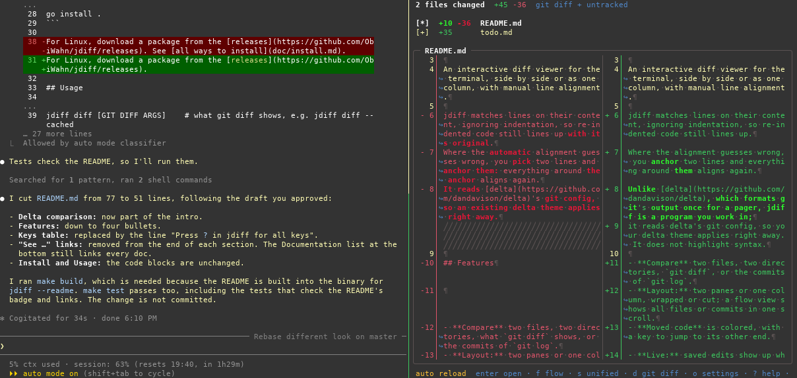

# jdiff
[](https://obiwahn.github.io/jdiff/coverage.html)

An interactive diff viewer for the terminal, with manual line alignment, that you keep open while you work: it lays the diff out again whenever the terminal is resized, and shows your saved edits without leaving it.

jdiff matches lines on their content, ignoring indentation, so re-indented code still lines up with its original.
Where the automatic alignment guesses wrong, you pick two lines and anchor them: everything around the anchor aligns again.
It reads [delta](https://github.com/dandavison/delta)'s git config, so an existing delta theme applies right away.

[](https://github.com/ObiWahn/jdiff/blob/assets/screenshots/gallery.md)
## Features

- **Compare** two files, two directories, what `git diff` shows, or the commits of `git log`.
- **Layout:** two panes or one column, wrapped or cut, switched while you look at the diff and laid out again on resize.
- **Context:** fold and unfold unchanged code.
- **Flow view:** all files of a diff, or all commits of the log, in one scrollable view.
- **Moved code:** colored, with a key to jump to its other end, also in another file.
- **Live:** saved edits show up while jdiff is open; anchors, folds and the cursor follow their lines.
- **Search and jump marks:** marks are kept per repository and survive restarts.
- **Whitespace:** only the added or removed part of an indentation is marked.

Unlike [delta](https://github.com/dandavison/delta), which formats git's output once for a pager, jdiff is a program you work in. delta highlights syntax; jdiff does not. See [all features](doc/features.md) and [screenshots](https://github.com/ObiWahn/jdiff/blob/assets/screenshots/gallery.md).

## Install

```sh
# macOS
brew tap ObiWahn/jdiff https://github.com/ObiWahn/jdiff.git
brew install --cask obiwahn/jdiff/jdiff

# Windows
scoop bucket add jdiff https://github.com/ObiWahn/jdiff
scoop install jdiff

# In a clone of this repository, with Go 1.26 or newer
go install .
```

For Linux, download a package from the [releases](https://github.com/ObiWahn/jdiff/releases). See [all ways to install](doc/install.md).

## Usage

```sh
jdiff OLD NEW                 # compare two files
jdiff DIR1 DIR2               # compare two directories
jdiff log [GIT LOG ARGS]      # browse commits, e.g. jdiff log -20
jdiff diff [GIT DIFF ARGS]    # what git diff shows, e.g. jdiff diff --cached
```

See [git aliases, difftool and more](doc/usage.md).

## Keys

`?` shows all key bindings.

| Key | Action |
|---|---|
| `j` `k` | move |
| `enter` | open; in a diff, mark a line, then its partner: anchor |
| `backspace` | back |
| `space` | fold or unfold unchanged code |
| `n` `p`, `N` `P` | next, previous file, commit |
| `f` | flow view |
| `s` | side by side or one column |
| `/` | search |
| `o` | settings |
| `q` | quit |

See [all key bindings](doc/keybindings.md).

## Documentation

- [Features](doc/features.md)
- [Install](doc/install.md)
- [Usage](doc/usage.md)
- [Key bindings](doc/keybindings.md)
- [Configuration](doc/config.md)
- [Development](doc/development.md)
