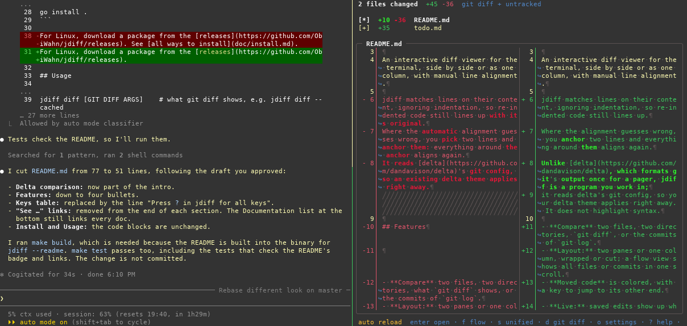
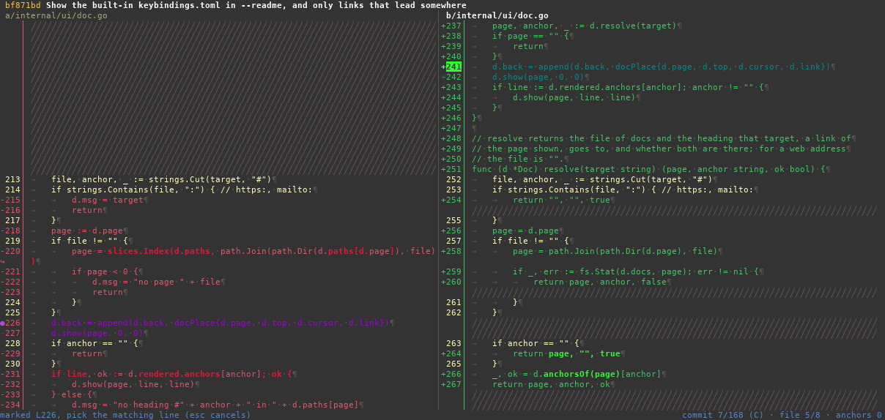
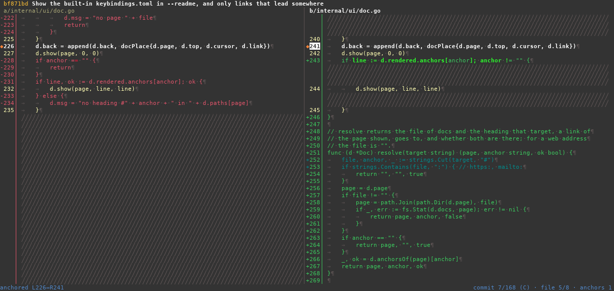
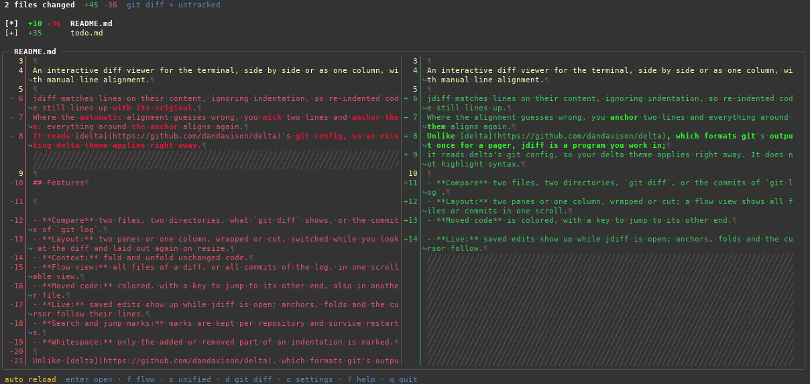
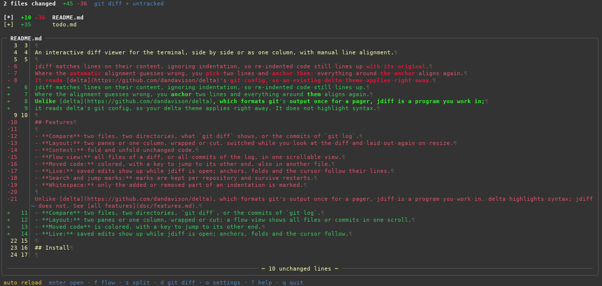
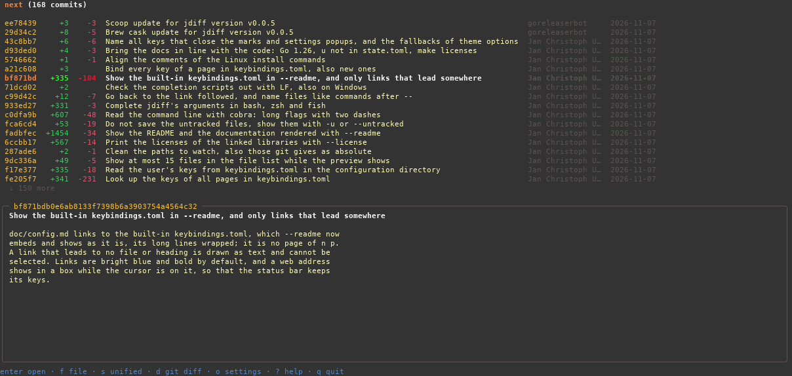
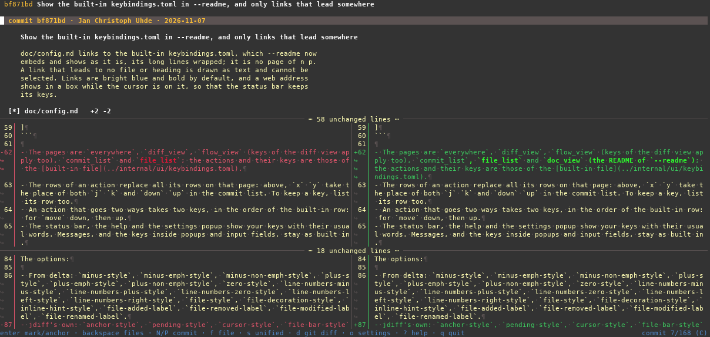

# jdiff screenshots

## Live

jdiff stays open beside a session that edits the README: saved edits show up without leaving it.

## Anchors

Where the alignment guesses wrong, mark a line on one side and pick its partner on the other.

Anchored, the code around the two lines lines up again.

## Side by side

The diff of a README, its long lines wrapped. Reworded lines are paired on their content.

## One column

The same diff in one column.

## Log

The commits of `git log`, with the message of the one under the cursor.

## Commit

A commit: its message, then the diff of its files, with unchanged lines folded.

